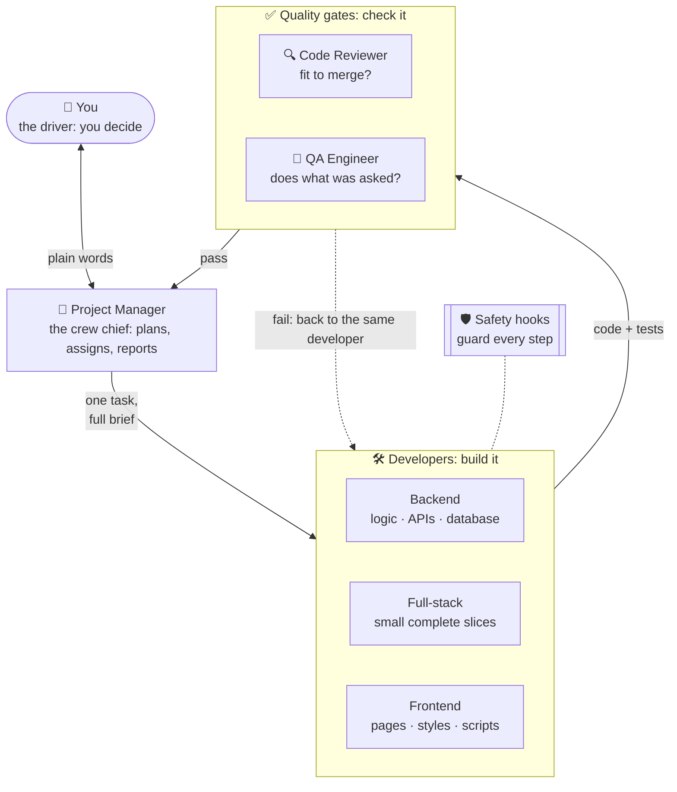
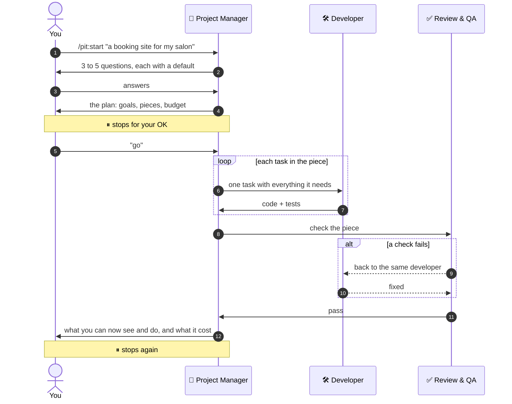
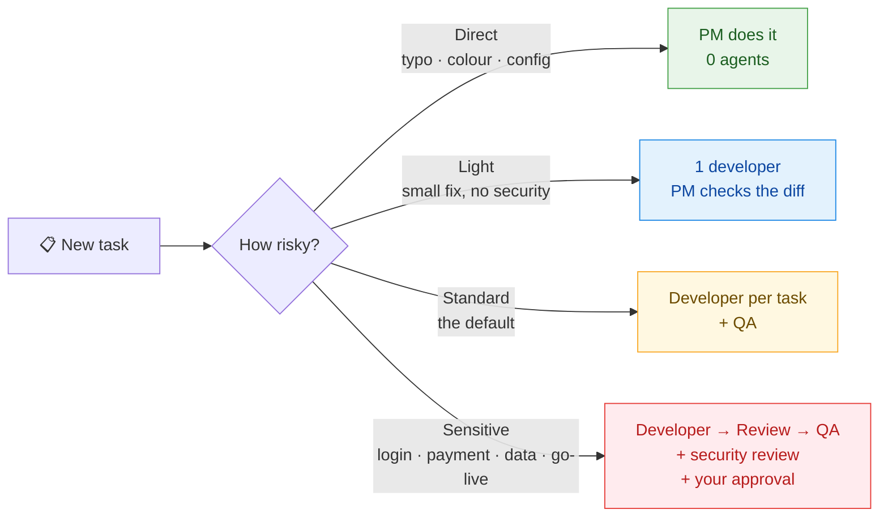
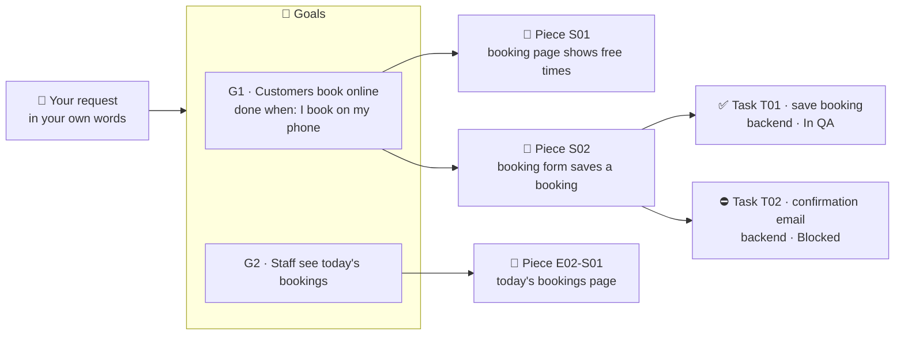

<div align="center">

# 🏁 PitCrew

### An AI dev team inside Claude Code that works fast and checks everything.

You talk to a **Project Manager** in plain words. It plans the work, hands each task to a specialist developer, and has every result checked by **code review** and **QA** before you see it.

[](CHANGELOG.md)
[](https://github.com/pitcrew-dev/pitcrew/actions/workflows/ci.yml)
[](#status-and-limits)
[](https://code.claude.com)

`/pit:start` · `/pit:next` · `/pit:fix` · `/pit:status` · `/pit:report`

</div>

---

## Contents

- [Why PitCrew](#why-pitcrew)
- [Meet the crew](#meet-the-crew)
- [How the crew works](#how-the-crew-works)
- [Install](#install)
- [Use](#use)
- [Your project board](#your-project-board)
- [Quick or Careful](#quick-or-careful)
- [Safety rules](#safety-rules)
- [Try it on the example project](#try-it-on-the-example-project)
- [Develop](#develop)
- [Status and limits](#status-and-limits)

---

## Why PitCrew

In Formula 1, a pit crew is a team of specialists: a crew chief gives the signal, each person does one job, and nothing leaves the pit until it has been checked. PitCrew runs your project the same way.

| | |
|---|---|
| 🧭 **One person to talk to** | The Project Manager speaks plain language, asks a few questions, and turns your idea into a plan you can see working, piece by piece. |
| 🏠 **Your existing code wins** | On an existing codebase it reads first, then follows the project's own conventions, versions and structure. No "modernising" your code as a side effect. |
| 🔍 **Independent checks** | A reviewer asks *is this fit to merge?* QA asks *does it do what was asked?* Neither one writes the fix, so neither can quietly cover up a problem. |
| ⚖️ **Effort matched to risk** | A typo costs nothing extra. Logins, payments, personal data and database changes always get the full checks, a security review and **your approval**. |
| 🛡️ **Safety that doesn't rely on memory** | Hooks keep agents out of `.env`, stop destructive commands and scan every written file for secrets, in every project. |
| 💰 **You always know the cost** | Every agent run is logged with its cost. Each piece of work has a budget: a warning at 80%, and at 100% it stops and asks you. |
| ⚡ **Careful with tokens** | Short agent briefs, standards read only when needed, reviews of the diff instead of the whole story, and fix rounds that continue the same agent instead of starting over. |

Built for PHP today: modern and legacy Laravel, plain PHP and WordPress. More stacks are on the [roadmap](#status-and-limits).

---

## Meet the crew



| Role | What it does | Writes the code? |
|---|---|---|
| 🧭 **Project Manager** | The main Claude session. Talks to you, asks questions, plans the work, picks the right developer, checks results and reports in plain words. Never writes production code itself. | No |
| 🛠️ **Backend Developer** | Business logic, APIs, database, jobs and integrations | Yes |
| 🎨 **Frontend Developer** | Templates, styles and the behaviour in the browser | Yes |
| 🧩 **Full-stack Developer** | A small complete slice, from server to page. The default in Quick mode. | Yes |
| 🔍 **Code Reviewer** | Reads the change against the project's conventions and the security rules. Decides if it is fit to merge. | No |
| 🧪 **QA Engineer** | Checks every promise in the task and tries to break it. Decides if it is delivered. | No (only throwaway test probes) |

Every developer writes tests it has **seen fail first**, then makes them pass. If something is unclear, it stops and asks the Project Manager instead of guessing.

---

## How the crew works

### From idea to working software



### Effort matched to risk

The Project Manager puts every task in a **lane**. The riskier the work, the more checks it gets.



**Sensitive work is never downgraded.** A failed check goes back to the **same** developer, with its context intact. Three failures on one task, twice the estimate, or a budget reached is a hard stop: the Project Manager brings it to you with a recommendation.

---

## Install

**You need:** [Claude Code](https://code.claude.com), Python 3.8+ (for the hooks, nothing else to install) and git.

In Claude Code:

```
/plugin marketplace add pitcrew-dev/pitcrew
/plugin install pit@pitcrew
```

Then restart Claude Code. To try it without installing, from a clone: `claude --plugin-dir ./plugin`.

It adds 5 agents (`pit:backend-developer`, `pit:frontend-developer`, `pit:full-stack-developer`, `pit:code-reviewer`, `pit:qa-engineer`), the 5 `/pit:` commands, the safety hooks, and an activity log with costs and budgets. It does not touch your `~/.claude/settings.json` or `CLAUDE.md`.

<details>
<summary><b>Upgrading from Agent Company (1.x)</b></summary>

PitCrew is the new name of Agent Company. The commands changed from `/company:` to `/pit:`. Remove the old plugin first, so the hooks don't run twice:

```
/plugin uninstall company@agent-company
/plugin marketplace remove agent-company
/plugin marketplace add pitcrew-dev/pitcrew
/plugin install pit@pitcrew
```

Your project files in `.claude/project/` keep working as they are.

If you still have version 0.2.x installed, the first session tells you, and shows the one command that removes it.
</details>

### Your first ten minutes

1. **Install** (above). Claude Code asks for two budgets: per piece of work ($12 is a good start) and per project (0 for no limit). You can change both later in `/config`.
2. **Open your project folder** in Claude Code, empty or with existing code.
3. **Say what you want**, for example `/pit:start I want a website for my salon where customers can book online`.
4. **Answer one round of 3 to 5 questions.** Every question has a default, so skip what you don't know. For existing code it reads the code first and asks less.
5. **Read the plan:** your goals, the pieces in order, what it assumed, what it left out, the budget, and what it needs from you. Ask for design options if you want to pick a look.
6. **Say "go"** and it builds the first piece.

In our test (a new salon booking site), steps 3 to 5 took about 4½ minutes of AI time and cost about $1.65.

---

## Use

From any project folder, in Claude Code:

| You say | Command | What happens |
|---|---|---|
| "I want to build a booking site" or "take over this codebase" | `/pit:start` | A short plain-language interview, a survey of any existing code, then a plan in pieces you can see working. **Stops for your approval.** |
| "go" / "next" | `/pit:next` | Builds one piece with the right checks, shows you the result and what it cost, and **stops**. |
| "it's broken" / "fix this error" | `/pit:fix` | One problem, one developer. It writes a test that fails, fixes it, shows it passing, and **stops**. |
| "where are we?" | `/pit:status` | One screen: progress per goal, money spent and left, what's next, and anything waiting on you. |
| "write me an update" | `/pit:report` | A one-page report for a client or manager, saved in `.claude/project/reports/`. |

---

## Your project board

Every project gets **its own board**. `/pit:start` creates it in your project folder as `.claude/project/plan.md`, and the Project Manager keeps it up to date after every step. It's a plain Markdown file, so you can read it anytime and commit it with your code.



| Level | What it is | Example |
|---|---|---|
| 🎯 **Goal** | An outcome you care about, with a plain test for "done" | "Customers can book online without calling", done when "I book on my phone and it shows in the admin list" |
| 🧩 **Piece** | Something you can see working, built in one `/pit:next` | "Booking form saves a booking", with its checks written as *Given / When / Then* |
| ✅ **Task** | One job for one developer, with its lane, state and date | "Save booking", backend developer, Standard lane, *In QA* |

**What the board looks like** (from the sample salon project):

```markdown
## Now
- Where we are: piece S02 (booking form saves a booking) is in QA; its email task is blocked.
- Next: S02-T02 once the owner gives the email sender address.
- Waiting on the owner: the email address that confirmation emails are sent from.

## Goals
| ID | Outcome                                    | Done when                                  | Progress     |
|----|--------------------------------------------|--------------------------------------------|--------------|
| G1 | Customers can book an appointment online   | I book on my phone and it shows in admin   | 1 of 2 stories |
| G2 | Staff see today's bookings at a glance     | I open the admin page and see today's list | 0 of 1 stories |

### SHOP-E01-S02 Booking form saves a booking
| Task             | What               | Role              | Lane     | State   | Note                         |
|------------------|--------------------|-------------------|----------|---------|------------------------------|
| SHOP-E01-S02-T01 | Save booking       | backend-developer | Standard | In QA   | Review PASS; QA next         |
| SHOP-E01-S02-T02 | Confirmation email | backend-developer | Standard | Blocked | Needs the owner's email address |

## Done
- SHOP-E01-S01 Booking page shows free times (G1). Review PASS, QA PASS.
```

- **"Now" is always at the top:** where things stand, what's next, and what's waiting on you.
- **Finished pieces shrink to one line** under *Done*, so the board stays short and cheap for the crew to read.
- **`/pit:status`** turns the board into one screen, adding money spent and left. **`/pit:report`** turns it into an update you can send.

### The crew's shared memory

The board sits with a few other working files in `<your-project>/.claude/project/`. Commit them: they carry the team's memory between sessions.

| File | What it holds |
|---|---|
| `plan.md` | **The project board:** where we are, your request, goals, the pieces with their tasks, and what's done |
| `decisions.md` | Choices and who made them, plus the risks |
| `conventions.md` | The project's own rules and how to check it |
| `lessons.md` | Mistakes not to repeat |
| `budget.md` | Budgets (default $12 a piece) and the mode |
| `activity.md` | One line per agent run, with its cost |

**Undo:** every task is its own commit, so you can say "undo that" or use Claude Code's `/rewind`.

---

## Quick or Careful

| | ⚡ Quick (default) | 🔬 Careful |
|---|---|---|
| Each task | One developer; the PM checks the diff and tests | Developer, then code review, then QA |
| End of a piece | One QA run for the whole piece | Already done per task |
| Logins, payments, personal data, database changes, going live | Always the full checks, plus your approval | Same |
| Rough cost per piece | About $7 (an estimate, not yet measured) | About $17 (pilot average) |

Turn Careful on in the plugin settings (`careful_mode`), or per project with a `Mode:` line in `budget.md`.

---

## Safety rules

A plugin cannot ship permission rules, so PitCrew enforces these with hooks, in every project:

| Kind | Rules |
|---|---|
| ⛔ **Denied** | Reading or writing `.env` files (not `.env.example`); `migrate:fresh`, `migrate:reset`, `db:wipe`; force-push |
| ✋ **Asks you first** | Every `git push`, `git reset --hard`, `git branch -D`, `migrate --force`, PowerShell `Remove-Item` |
| 🛡️ **Guarded** | Blocks writes to `vendor/`, `node_modules/`, build output, lock files, WordPress core, `wp-config.php` and private keys; stops irreversible Bash and PowerShell commands; flags secrets in written files; formats PHP with the project's own Pint when that can't reformat old code |

A search over a whole folder can still match lines inside `.env`. Only a path that points straight at a `.env` file is blocked.

---

## Try it on the example project

`plugin/evals/fixtures/salon/` is a half-built salon booking site with its project files filled in. Copy it somewhere, open the copy in Claude Code with the plugin loaded, and try `/pit:status` or `/pit:report`.

---

## Develop

```bash
python -m unittest discover -s tests -v   # the hooks, manifests and uninstaller
claude plugin validate ./plugin --strict  # the plugin files
cd plugin && claude plugin eval . --scaffold --trust-plugin --runs 1 --ablation none   # the evals (paid)
```

The evals in `plugin/evals/` cover starting a project, a story stopped by its budget, status, the report, the fix command, and the notice about an old install. They are real model calls. On Windows, status and report can't run their cost script (shell commands need a sandbox Windows doesn't have), so run the full suite on Linux or macOS, or in CI.

CI (`.github/workflows/ci.yml`) runs the tests on Windows, macOS and Linux and checks the plugin on every push. The evals run when started by hand, with an `ANTHROPIC_API_KEY` secret.

See `CLAUDE.md` for the layout and the rules for changing the framework, and `CHANGELOG.md` for what changed.

---

## Status and limits

- **Version 2.0.0.** Piloted on one real Laravel project; the findings are in `report/`.
- **Stacks:** PHP today (Laravel, plain PHP, WordPress). Frontend frameworks, databases and other languages are planned.
- **Roles:** six of eleven are written. There is no dedicated security, architecture or devops agent yet: the PM covers them, or asks you.
- **Safety is a floor, not a gate.** A Bash permission rule isn't a hard security boundary (`git -C . push` is spelled differently from `git push`), which is why the hooks back them up.
- **Tested** by hand on Windows (Git Bash and PowerShell). CI runs the tests on macOS and Linux too.
- **Costs are API-equivalent:** what the work would cost at Anthropic's pay-per-use prices. On a subscription you don't pay this per token; it shows where the effort went.
- **License:** MIT.

<div align="center">

**🏁 PitCrew: you drive, the crew builds.**

</div>
